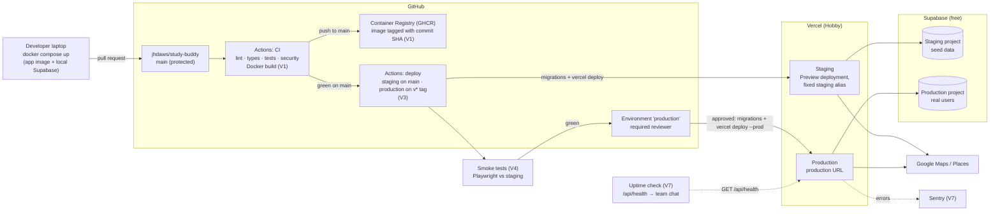

# Deployment

Where Study Buddy runs, and how a change gets from a pull request to
students. The reasons are in [ADR 0012](./adr/0012-hosting-and-release.md).
The step-by-step operations (deploy, promote, roll back, where the logs are)
will be in `docs/ops/RUNBOOK.md` (D9, #162).

> **Status (2026-11-27):** the pipeline is written (V3, #149:
> `.github/workflows/deploy.yml`, `vercel.json`) but is a no-op until the
> staging project and the GitHub and Vercel settings in "One-time setup"
> below exist. The smoke tests (V4) plug into
> `.github/workflows/smoke-tests.yml`; until then it holds a one-request
> placeholder. The rows marked *(V1–V7)* land with those issues (#147–#153).

## Deployment diagram

The browser talks to Supabase directly as well as through our server, as it
does today (`docs/architecture.md`, "Container diagram"). That is why each
environment's `NEXT_PUBLIC_SUPABASE_*` values point at its own project.

## Environments

| | Local | Staging | Production |
| --- | --- | --- | --- |
| Runs on | Docker (`docker compose up`) or `npm run dev` + `npm run db:start` | Vercel Preview, aliased | Vercel Production |
| Built from | The working tree | The commit merged to main | The tagged commit that passed on staging |
| Database | Local Supabase in Docker | Supabase staging project | Supabase production project |
| Data | `supabase/seed.sql` | `supabase/seed.sql` plus the smoke-test account | Real users, plus the grader accounts listed in the README |
| Settings come from | `.env` (copied from `.env.example`) | Vercel Preview env + GitHub `staging` environment | Vercel Production env + GitHub `production` environment |
| Who can deploy | Anyone, to their own machine | GitHub Actions only | GitHub Actions only, after approval |

## From pull request to production

1. **Pull request.** CI runs lint, types, unit, db, e2e and the security
   stage, and builds the Docker image. Main is protected: the checks must
   pass and a teammate must approve.
2. **Merge to main.** CI pushes the image to GHCR. `deploy.yml` applies
   new migrations to staging. The deploy workflow deploys the commit to
   staging, then the smoke tests run against it.
3. **Release tag.** `git tag v1.0.0` on a commit from main whose staging
   smoke run is green. The production job waits for a teammate's approval in
   the `production` environment, then runs migrations on production and
   `vercel deploy --prod` for that commit.
4. **If production is bad,** Vercel Instant Rollback restores the previous
   deployment (`docs/ops/RUNBOOK.md`).

## One-time setup (V3, #149)

`deploy.yml` skips staging with a notice until these exist, and fails a
release tag loudly if production is missing any. Names only here: every
value goes straight from the dashboard that issues it into the setting that
holds it, never into chat, a commit or an issue.

### 1. Staging Supabase project

1. supabase.com → **New project** in the same organization. Name it
   `study-buddy-staging`. **Region: the same as production's** (production →
   Project Settings → General shows it). Keep the database password in a
   password manager.
2. Load the schema and the seed once, from your laptop, without relinking it
   (this does not touch your local stack):
   `npx supabase db push --db-url "<staging connection string>" --include-seed`.
   The connection string is under the project's **Connect** button (Session
   pooler). From then on, `deploy.yml` applies new migrations on every merge.
3. Copy production's auth settings to staging (`supabase/README.md`, "Hosted
   auth settings"), with the staging URL (`https://<STAGING_HOST>`, below) as
   the Site URL and in the redirect list.

### 2. Vercel

1. **Token:** vercel.com → Account Settings → Tokens → Create. Scope: the
   account that owns `study-buddy`; expiry: after the course ends (an expired
   token is a known failure mode, `docs/ops/RUNBOOK.md`). It goes into GitHub
   in step 3.
2. **IDs (not secret):** the project's Settings → General shows the
   **Project ID**; Account Settings → General shows your **Vercel ID** (the
   "org" for a personal account). `vercel link` on a laptop writes both into
   `.vercel/project.json`, which is gitignored.
3. **Environment variables** (project → Settings → Environment Variables).
   **Preview** = staging, **Production** = production; never the same
   Supabase values in both (SEC-08):

   | Name | Preview (staging) | Production |
   | --- | --- | --- |
   | `NEXT_PUBLIC_SUPABASE_URL`, `NEXT_PUBLIC_SUPABASE_ANON_KEY` | staging project | production project |
   | `SUPABASE_SECRET_KEY` | staging project | production project (account deletion needs it, ADR 0010) |
   | `NEXT_PUBLIC_GOOGLE_MAPS_API_KEY`, `GOOGLE_MAPS_SERVER_API_KEY` | both or neither (BUG-19); add `https://<STAGING_HOST>/*` to the browser key's referrers | both |

4. **Protection bypass for the smoke tests:** project → Settings →
   Deployment Protection → **Protection Bypass for Automation** → create a
   secret. Keep Vercel Authentication on for previews.
5. **Staging host:** pick a free `*.vercel.app` name, for example
   `study-buddy-staging-jdaws.vercel.app`. The first staging deploy claims it
   with `vercel alias set`.

### 3. GitHub

Settings → Secrets and variables → Actions → **Variables**: `VERCEL_ORG_ID`,
`VERCEL_PROJECT_ID`.

Settings → Environments:

| | `staging` | `production` |
| --- | --- | --- |
| Deployment branches and tags | Selected: branch `main` | Selected: branch `main` (the by-hand `deploy-db.yml`) and tag `v*` |
| Required reviewers | none | the other three teammates, **Prevent self-review** on |
| Secrets | `VERCEL_TOKEN`, `VERCEL_AUTOMATION_BYPASS_SECRET`, `SUPABASE_ACCESS_TOKEN` (+ whatever V4 adds for the staging test account) | `VERCEL_TOKEN`, `SUPABASE_ACCESS_TOKEN` (already there) |
| Variables | `SUPABASE_PROJECT_ID` (staging's ref), `STAGING_HOST` | `SUPABASE_PROJECT_ID` (already there), `PRODUCTION_URL` = `https://study-buddy-jdaws.vercel.app` |

Settings → Rules → Rulesets → "main protection" → Require status checks: add
`docker`. The smoke tests are **not** a pull-request check (they run after
the merge, against staging), so they cannot be added there; the
`release-gate` job in `deploy.yml` is what makes them block a promotion.

### What the pipeline checks, and where

| Guard | Where |
| --- | --- |
| Only Actions deploys; no preview per branch | `vercel.json` (`git.deploymentEnabled: false`) |
| Staging only from a green CI run for a push to main, or by hand from main | `deploy.yml`, `staging` job's `if` (SEC-13) |
| Production only from a `v*` tag on a commit from main, whose "staging smoke" status is green, and whose `package.json` version matches the tag | `deploy.yml`, `release-gate` job → `scripts/release-gate.mjs` |
| A teammate other than the tagger approves | the `production` environment's reviewers |
| Each environment's secrets only reach main or a `v*` tag | the environments' deployment-branch rules |

`src/lib/release-pipeline.test.ts` and `src/lib/auth-settings.test.ts` fail
if the gate's refusals or these workflow guards are removed.
