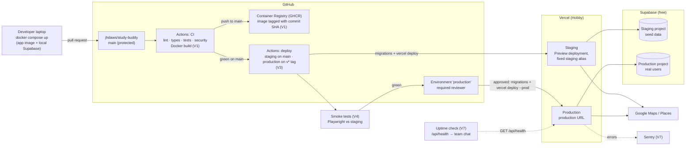

# Deployment

Where Study Buddy runs, and how a change gets from a pull request to
students. The reasons are in [ADR 0012](./adr/0012-hosting-and-release.md).
The step-by-step operations (deploy, promote, roll back, where the logs are)
will be in `docs/ops/RUNBOOK.md` (D9, #162).

> **Status (2026-11-17):** this is the Sprint 5 target. What runs today is
> production only: Vercel deploys on every push, and there is no staging
> database. The rows marked *(V1–V7)* land with those issues (#147–#153).

## Deployment diagram

The browser talks to Supabase directly as well as through our server, as it
does today (`docs/architecture.md`, "Container diagram"). That is why each
environment's `NEXT_PUBLIC_SUPABASE_*` values point at its own project.

## Environments

| | Local | Staging | Production |
| --- | --- | --- | --- |
| Runs on | Docker (`docker compose up`) or `npm run dev` + `npm run db:start` | Vercel Preview, aliased | Vercel Production |
| Built from | The working tree | The commit merged to main | The tagged commit that passed on staging |
| Database | Local Supabase in Docker | Supabase staging project | Supabase production project |
| Data | `supabase/seed.sql` | `supabase/seed.sql` plus the smoke-test account | Real users, plus the grader accounts listed in the README |
| Settings come from | `.env` (copied from `.env.example`) | Vercel Preview env + GitHub `staging` environment | Vercel Production env + GitHub `production` environment |
| Who can deploy | Anyone, to their own machine | GitHub Actions only | GitHub Actions only, after approval |

## From pull request to production

1. **Pull request.** CI runs lint, types, unit, db, e2e and the security
   stage, and builds the Docker image. Main is protected: the checks must
   pass and a teammate must approve.
2. **Merge to main.** CI pushes the image to GHCR. `deploy-db.yml` applies
   new migrations to staging. The deploy workflow deploys the commit to
   staging, then the smoke tests run against it.
3. **Release tag.** `git tag v1.0.0` on a commit from main whose staging
   smoke run is green. The production job waits for a teammate's approval in
   the `production` environment, then runs migrations on production and
   `vercel deploy --prod` for that commit.
4. **If production is bad,** Vercel Instant Rollback restores the previous
   deployment (`docs/ops/RUNBOOK.md`).
