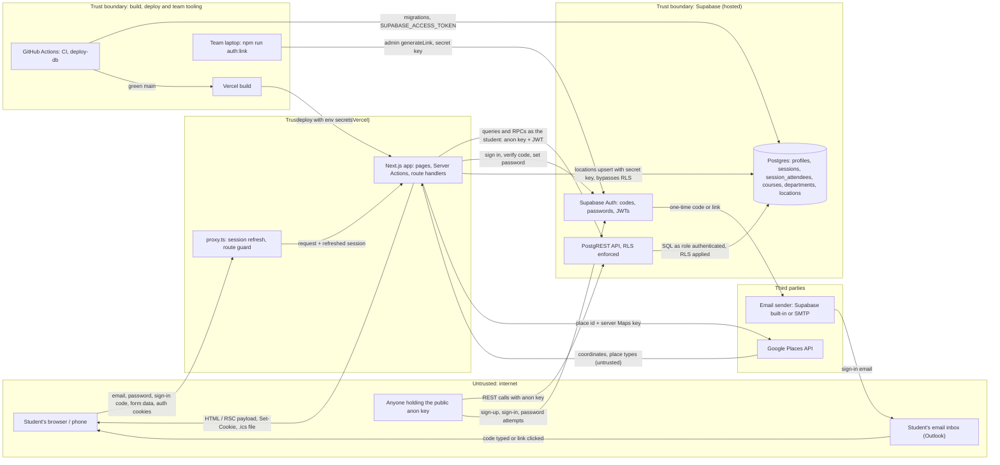

# Threat model -- Study Buddy (Group 4)   (docs/security/threat-model.md)
Last updated: 2026-11-03 · Authors: Jack Dawson (scribe), Nate Dalbert, Moses Banda, Tapan Sidhwani · Covers: main @ `3e89506` + production https://study-buddy-jdaws.vercel.app

There is no separate staging deployment yet: Vercel preview deployments run against the
production Supabase project (W10, #54). That gap is threat T11 below. ICA 15 / Sprint 4 Part 2a;
findings get severities and fixes in Part 2d.

## 1. Data-flow diagram (DFD)
Dashed subgraphs = trust boundaries. Every arrow is labelled with the data that crosses it.

## 2. Assets (what an attacker wants)
| Asset | Where it lives | Why it matters |
|-------|----------------|----------------|
| User accounts / sessions | Supabase Auth (`auth.users`, password hashes, refresh tokens); `sb-*` auth cookies in the browser | **High.** A stolen session or password lets someone host and join sessions as that student. |
| Personal data: Vanderbilt emails | `auth.users` only; the app never selects them (US-25) | **High.** Emails identify students, and keeping them private is a backlog promise. |
| Personal data: where and when a student will be | `sessions` (place, room, time), `session_attendees`, `profiles.display_name` | **High.** Together these tell a stranger where a named student will be, and when. |
| API keys and tokens | Vercel env vars (`SUPABASE_SECRET_KEY`, Google Maps server key); GitHub `production` environment (`SUPABASE_ACCESS_TOKEN`); `.env.hosted` on team laptops; SMTP credentials in the Supabase dashboard | **High.** The secret key bypasses RLS; the access token can change the production schema. |
| Money / quota | Google Cloud billing (Places lookups); Supabase and SMTP email quotas | **Medium.** Abuse runs up cost, or uses the email quota so real students can't sign up. |
| Shared course catalogue | `departments`, `courses` (students add rows) | **Medium.** Junk rows degrade the course picker for everyone. |
| Rosters and seat counts | `session_attendees`, written only by `join_session` / `leave_session` | **Medium.** Fake attendees or overbooking break the core feature. |

## 3. STRIDE table (at least 8 rows, across at least 3 boundaries)
| # | Boundary (A -> B) | STRIDE | Asset | Threat (one sentence) | Existing control | Gap? -> Finding ID |
|---|-------------------|--------|-------|-----------------------|------------------|--------------------|
| T1 | Internet -> Supabase Auth | S | Accounts | Anyone can sign in as the old demo account `njpm@vanderbilt.edu`, whose password is written in `HANDOFF.md` and `docs/ai-usage-log.md` in this public repo, using only the public anon key. | The app code for the demo login was removed (#55, #82). Not confirmed that the hosted user was deleted. | Gap -> SEC-01 |
| T2 | Browser -> Next.js (`/login`) | S | Accounts | An attacker guesses a student's password by trying many logins through `/login` or Supabase's token endpoint. | Supabase Auth limits sign-ins per IP (`sign_in_sign_ups = 30` per 5 min locally; hosted is a dashboard setting); minimum length 8 in the form and `config.toml`; errors never say whether an account exists. | Gap: hosted minimum length not confirmed at 8; no CAPTCHA or lockout -> SEC-02 |
| T3 | Browser -> Next.js (Server Actions) | T | Rosters, sessions | A student forges a Server Action request to create a session as someone else, or to join with another student's id. | Host and joiner come from `auth.uid()` inside SECURITY DEFINER functions, never from the form; `requireUser()` in every action; Next.js checks the Origin of Server Action POSTs. | No gap (tests: `tests/db/session-rules.test.ts`, `tests/db/join-leave-session.test.ts`) |
| T4 | Internet -> Supabase API (anon key) | E | Rosters, profiles | A signed-in student calls PostgREST directly to add themselves to a full session or edit another student's profile. | RLS on every table; no INSERT/UPDATE/DELETE policy on `sessions` or `session_attendees`; `profiles` update limited to your own row and the `display_name` column; `anon` revoked. | No gap (tests in `tests/db/`) |
| T5 | Internet -> Supabase API (anon key) | T | Course catalogue | A signed-in student scripts thousands of junk departments and courses through PostgREST; the insert policy only checks `created_by = auth.uid()`. | Length CHECK constraints (BUG-07); `created_by` records who added each row. | Gap: no rate or count limit -> SEC-03 |
| T6 | Browser -> Next.js (`/sessions`) | I | Where and when a student will be | Any Vanderbilt account can see every open session's place, time and roster names, so someone could track where a named student will be. | Vanderbilt-only sign-up (database trigger); display names, never emails; signed-out visitors see nothing. | Accepted risk by design (US-23); report and block are backlog items US-18, US-22 |
| T7 | Next.js -> Supabase Auth -> email sender | D | Email quota | Anyone can request sign-up codes for many `@vanderbilt.edu` addresses, using up the hourly email limit and sending students unwanted email. | Supabase's 60-second per-address throttle and hourly cap; Vanderbilt-only addresses. | Gap: no CAPTCHA on code requests -> SEC-04 |
| T8 | Next.js -> Google Places | D | Google quota / money | A signed-in student submits the create form in a loop with real place ids, and each submit triggers a billed Places lookup. | Lookups only for signed-in users; 5-second timeout; Google quota cap (M1). Production has no Maps key yet, so only fixture places run. | Gap: no per-user limit (noted in `src/lib/places.ts`) -> SEC-05, before M2 (#84) ships |
| T9 | Internet -> Next.js (our server) | D / E | Whole app | The deployed Next.js 16.4.0 has published advisories (`npm audit`: 1 critical, 2 high), including a denial of service through Server Actions, which we use. | Dependabot; #71 bumps Next.js to 16.4.2, below the fixed 16.4.4. | Gap -> SEC-06 (triage which advisories are reachable) |
| T10 | GitHub Actions -> Supabase (deploy) | T | Database, tokens | A compromised GitHub Action or npm package in the deploy workflow could read `SUPABASE_ACCESS_TOKEN` and change the production database. | The token lives only in the `production` environment and is used only by `deploy-db` on main after CI passes; pull requests from forks get no secrets. | Gap: actions pinned to major tags, not commit SHAs; no secret scan or SAST in CI yet -> SEC-07 |
| T11 | Vercel preview -> Supabase (production) | T / I | All data | Code in any open pull request runs on a Vercel preview against the production Supabase project, so an unreviewed branch can read or change real data. | Previews deploy only for collaborators' branches. | Gap: no staging project (W10, #54) -> SEC-08 |
| T12 | Browser -> Next.js | R | Accounts, rosters | A burst of failed sign-ins or refused joins goes unnoticed, and a student can deny an action, because the app keeps no audit log. | `joined_at` timestamps; Supabase Auth logs; Vercel function logs (short retention); `console.error` on failed RPCs in `src/app/sessions/actions.ts`. | Gap: no app log of failed sign-ins or refused actions -> SEC-09 |
| T13 | Next.js -> Browser | I | Accounts | Supabase's auth cookies are readable by JavaScript, so any XSS would leak sessions, and no Content-Security-Policy or other security headers are set. | React escapes all output; no `dangerouslySetInnerHTML`; `.ics` text escaped (`src/lib/ics.ts`). | Gap: no CSP or security headers (`next.config.ts`) -> SEC-10 |

## 4. OWASP Top 10:2025 checklist -- owner per category
Owners do the manual review in Sprint 4 Part 2c. "Result" is filled in as each check is done.
Results below are from the 2c review of main @ `a578559` (2026-11-09). Each finding's severity,
evidence and fix are in [`findings.md`](./findings.md).

Not verified anywhere in this review: hosted settings this environment cannot see. That means
the Supabase dashboard, Vercel environment variables, GitHub environment rules, and production's
own response headers (the proxy blocks `*.vercel.app`). Every result that depends on one says
so, and its finding is rated as if the setting is wrong until someone records it.

| Category | Owner | What we checked (where) | Result: pass / finding (ID) / N/A + reason |
|----------|-------|-------------------------|--------------------------------------------|
| A01 Broken Access Control (try changing an ID as another user) | Nate | Open `/sessions/[id]` and `/sessions/[id]/calendar.ics` as another test user; call `join_session`, `leave_session` and PostgREST with another user's ids; update another profile (`src/app/sessions/`, RLS in `supabase/migrations/`) | **Pass.** `tests/db/idor.test.ts` runs as a second signed-in user against real Postgres. Each attempt is refused: updating or upserting another student's profile; inserting into `session_attendees` directly, for yourself or someone else; moving or removing someone's seat; `leave_session` on a session you're not in (and it has no user-id parameter to name anyone else); reading another student's email; changing, deleting or forging someone else's session; adding catalogue rows in someone else's name. A signed-out caller sees no session, roster or profile. Mutation-checked: adding a permissive policy or an email grant makes the matching test fail. `/sessions/[id]` and `calendar.ics` need sign-in (proxy, `requireUser()`); any signed-in student may read any open session, by design (T6). Defence-in-depth gap: **SEC-14** (Low). |
| A02 Security Misconfiguration | Jack | Supabase dashboard (URL configuration, Confirm email, minimum password length); Vercel env var scopes; previews on production data; security headers in `next.config.ts` | **Findings:** • **SEC-11** (Critical until verified). `config.toml` has "Confirm email" off; with it off, a local sign-up through the public API got a confirmed account for any Vanderbilt address. The hosted toggle is unverified. • **SEC-08** (High). Vercel built a preview for Dependabot's #87. • **SEC-10** (Low). A local production build sends no CSP, `X-Frame-Options`, `X-Content-Type-Options` or `Referrer-Policy`. Not verified: URL configuration, minimum password length, and Vercel environment-variable scopes (no dashboard access). |
| A03 Software Supply Chain Failures | Jack | `npm audit --audit-level=high`, `package-lock.json` committed, Dependabot, action pinning in `.github/workflows/` | **Findings:** SEC-06 (Critical; fix #88: next 16.4.5) and SEC-07 (Medium; fixes #88 for the CI security stage and #89 for SHA-pinned actions). Dev-only advisories are cleared in #90, except one accepted minimatch advisory (`scans.md` §4). `package-lock.json` is committed and `npm ci` is used everywhere. Dependabot covers npm and github-actions. |
| A04 Cryptographic Failures | Moses | Passwords hashed by Supabase Auth; HTTPS on `vercel.app`; secrets server-only (`src/lib/env.ts`, `src/lib/supabase/admin.ts`, only the anon key is `NEXT_PUBLIC_`); credentials written in the repo | **Pass for code; Finding: SEC-01** (Critical until the hosted demo user is confirmed deleted). • The only public variables are the Supabase URL, the anon key and the browser Maps key. • The secret key and the server Maps key are used only in `server-only` modules (`admin.ts`, `places.ts`, `sessions.ts`). • A production build's `.next/static` contains none of `SUPABASE_SECRET_KEY`, `GOOGLE_MAPS_SERVER_API_KEY`, `sb_secret_`, `service_role` or `createAdminClient`. • Passwords are bcrypt (`$2a$`) in `auth.users`, checked locally. • gitleaks finds no other secret in the history (#88). Not verified: HTTPS/HSTS on production (blocked here). |
| A05 Injection | Nate | PostgREST filters built from user input (`searchCourses` in `src/lib/sessions.ts`), RPC arguments, React output, `.ics` escaping (`src/lib/ics.ts`), no raw SQL in the app | **Pass.** • `searchCourses` interpolates input into a PostgREST `.or()` filter, but only after `titleNeedle()` has reduced it to letters, digits and spaces, so filter syntax can't be injected. • RPC arguments are typed parameters, and the app has no raw SQL. • `src/` has no `dangerouslySetInnerHTML`, `innerHTML`, `eval` or `new Function`. • `.ics` text escapes backslash, `;`, `,` and newlines, and the `Content-Disposition` filename is slugged to `[a-z0-9-]`. • The SECURITY DEFINER functions use `search_path = public`, but no client role can CREATE in `public` (tested). • Semgrep: 0 findings (`scans.md`, #88). |
| A06 Insecure Design | Tapan | Seat limit and row lock (`join_session`); limits on catalogue inserts, code requests and Places lookups (T5, T7, T8) | **Seat limit: pass.** The US-07b race test in `join-leave-session.test.ts` has two students take the last seat at once, and exactly one wins. **Findings:** • **SEC-03** (Medium): nothing caps catalogue inserts. • **SEC-04** (Medium): code requests have no CAPTCHA. • **SEC-05** (Low today, because production has no server Maps key; Medium once M2 ships): no per-user limit on Places lookups. • **SEC-12** (Medium): wrong guesses never invalidate a sign-in code. No rate limit exists anywhere in the app. |
| A07 Authentication Failures | Moses | Login rate limit; enumeration in messages (`src/lib/errors.ts`); forgot-password flow (code -> `/login/password`); sign-out ends the session; session expiry | **Findings:** • **SEC-12** (Medium): locally, 40 wrong guesses got no 429, and the real code still worked afterwards. • **SEC-02** (Medium): no lockout or CAPTCHA. • **SEC-15** (Low): `/login/password` changes a password for any session, with no re-entry. • **SEC-16** (Low): no session timebox, and 400-day cookies. **Pass:** • App messages never reveal whether an account exists (`invalid_credentials` gets one message). The Auth API does reveal it while "Confirm email" is off (SEC-11). • Forgot-password goes code → `/login/password`. • Sign-out revokes this device's session (`scope: "local"`). • `getUser()`, never `getSession()`. Not verified: the hosted rate limits and minimum length. |
| A08 Software or Data Integrity Failures | Jack | Secrets only in GitHub environments; fork PRs can't read them; deploy only from main (`deploy-db.yml`, Vercel production branch) | **Finding: SEC-13** (Medium). `deploy-db.yml`'s `workflow_dispatch` deploys whichever branch it is run from. Not verified: the `production` environment's deployment-branch rule. **Pass:** • Automatic deploys run only after a green CI on a push to main (`workflow_run` guard). • Secrets live only in GitHub environments. • Fork PRs get no secrets. • Actions are SHA-pinned in #89 (SEC-07). |
| A09 Security Logging & Alerting Failures | Tapan | Failed sign-ins and refused actions logged without passwords or tokens (`src/app/*/actions.ts`, Supabase Auth logs) | **Finding: SEC-09** (Low): the login actions log nothing, and the sessions actions log only failed RPCs. **Pass:** what is logged carries no passwords or tokens. A grep of every `console.*` in `src/` finds only error codes and messages, place ids, and `error.name` (deliberately not the error object, which could carry the Maps key). |
| A10 Mishandling of Exceptional Conditions | Tapan | Errors mapped through `src/lib/errors.ts` (no raw Postgres text); `requireUser()` fails closed; `error.tsx` pages; `resolvePlace` failure paths | **Pass.** • `databaseErrorMessage()` returns only allowlisted raise, constraint and SQLSTATE messages, with a generic fallback. • `requireUser()` fails closed: no user means a redirect, and a failed profile read throws to the error boundary. • `sessions/error.tsx` never shows `error.message`. • Every `resolvePlace` failure becomes `lookup_failed` or a named reason, and Google's and Postgres's text goes only to logs. Info: there is no root `error.tsx` or `global-error.tsx`. Errors outside `/sessions` get Next's default page, which in production is generic with no stack trace. |

## 5. Top 3 risks and next actions
1. **SEC-06: the deployed Next.js 16.4.0 has a critical advisory.** Upgrade `next` to 16.4.4 or later in its own PR, triage which advisories we were exposed to, and add `npm audit --audit-level=high` to the CI security stage so this blocks a pull request next time.
2. **SEC-01: a demo password is public in the repo.** Check Supabase Auth -> Users for `njpm@vanderbilt.edu` and delete it if it exists. Add gitleaks to CI so a committed credential fails the build.
3. **SEC-08: pull-request previews use the production database.** Create the staging Supabase project (W10, #54), give Vercel's Preview environment its keys, and set staging's `SUPABASE_PROJECT_ID` so migrations reach it first.
